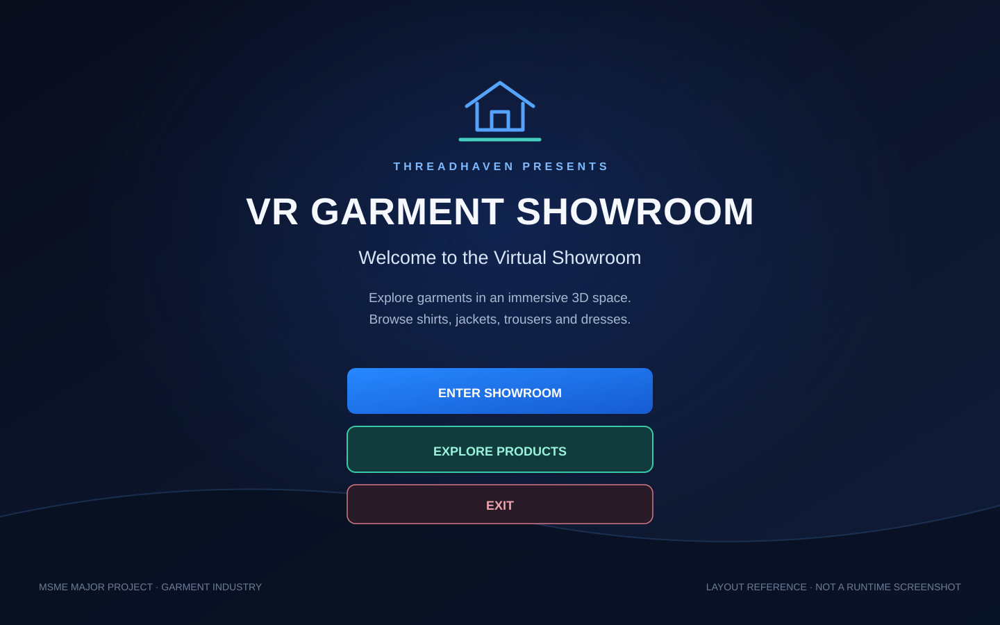
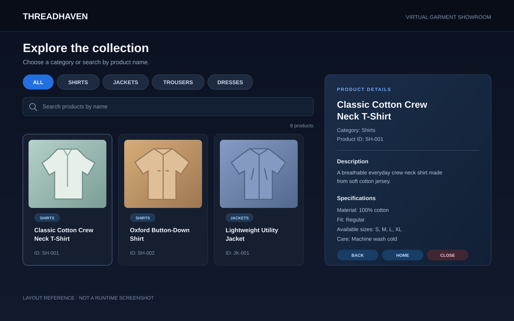

# UI layout reference visuals

These SVGs are reference layouts for the intended menu and catalogue screens. They are drawn from Member 3's script labels, product data, and layout notes. They are **not screenshots from a running Unity build**: `MainMenuScene.unity` currently has an empty Canvas, and the catalogue UI still needs to be assembled and wired in the Unity Editor. Capture and add runtime screenshots after that scene work is complete.

## Main menu reference

## Product catalogue and details reference

