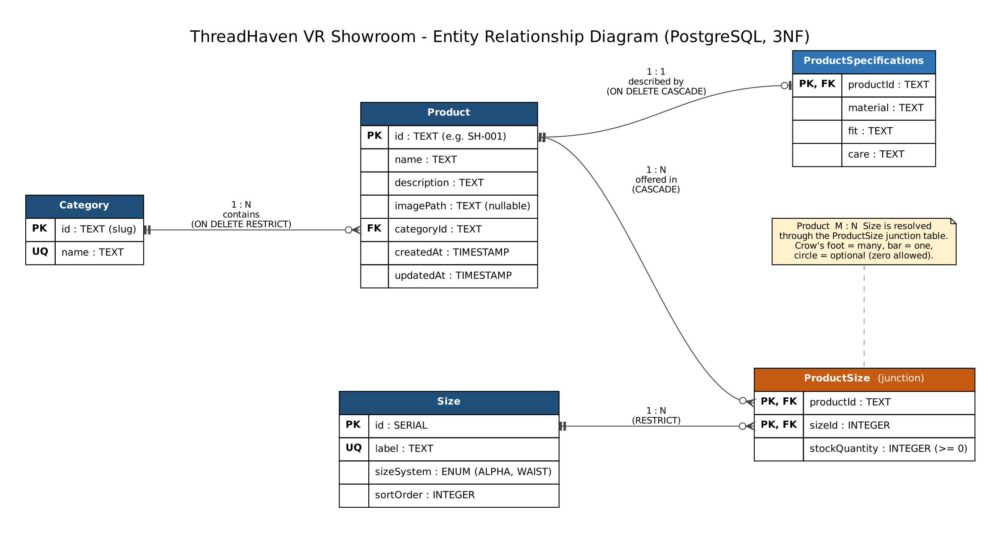
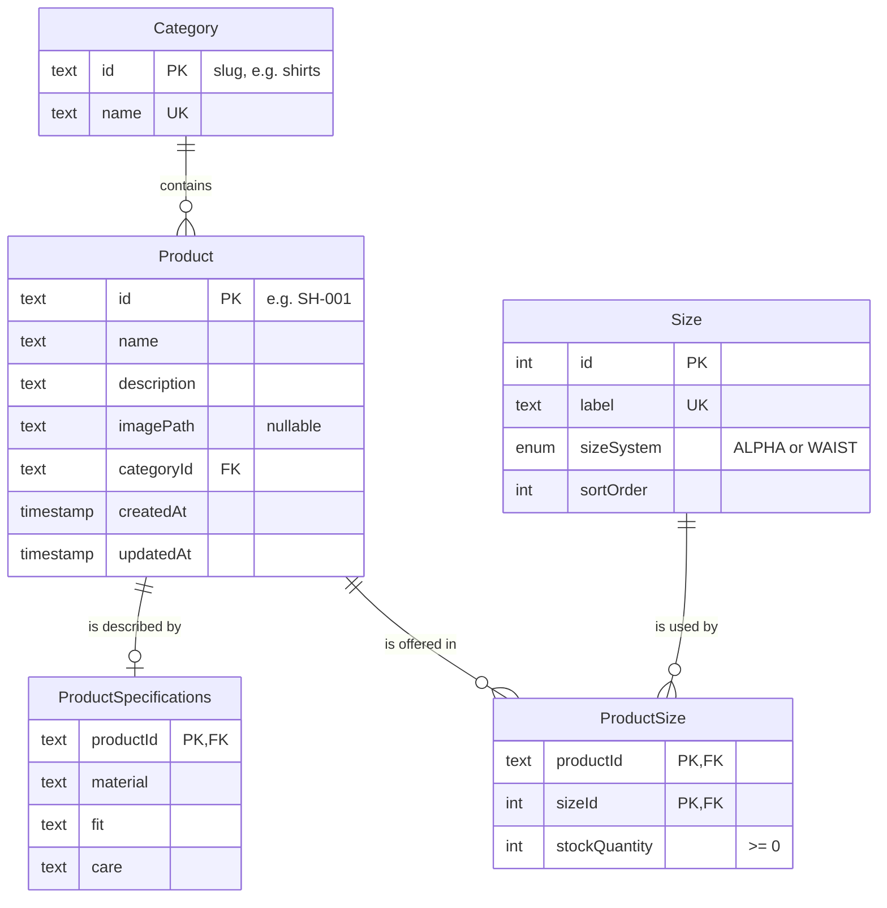

# 2. ER Diagram and Data Modelling

Source files: [`diagrams/er_diagram.dot`](diagrams/er_diagram.dot) (Graphviz)
and [`diagrams/er_diagram.svg`](diagrams/er_diagram.svg). A Mermaid version
that GitHub renders directly is at the bottom of this page.

## Entities and attributes

| Entity | Attributes | Primary key | Foreign keys | Other keys / rules |
|---|---|---|---|---|
| **Category** | id, name | `id` (slug, e.g. `shirts`) | none | `name` UNIQUE; slug format CHECK |
| **Product** | id, name, description, imagePath, categoryId, createdAt, updatedAt | `id` (e.g. `SH-001`) | `categoryId` → Category.id | code format CHECK (`AA-000`); name/description not blank |
| **ProductSpecifications** | productId, material, fit, care | `productId` | `productId` → Product.id | none |
| **Size** | id, label, sizeSystem, sortOrder | `id` (auto number) | none | `label` UNIQUE; `sizeSystem` ENUM (ALPHA, WAIST); `sortOrder` > 0 |
| **ProductSize** | productId, sizeId, stockQuantity | (`productId`, `sizeId`) composite | `productId` → Product.id, `sizeId` → Size.id | `stockQuantity` ≥ 0, default 0 |

## Relationships

| Relationship | Type | How it is implemented | On delete |
|---|---|---|---|
| Category **contains** Product | **One-to-many (1 : N)** | `Product.categoryId` FK. A category has 0..N products; a product has exactly 1 category (NOT NULL). | **RESTRICT**: a category with products cannot be deleted |
| Product **is described by** ProductSpecifications | **One-to-one (1 : 1)** | `ProductSpecifications.productId` is both the PK and the FK, so a product can have at most one specifications row. The row is optional (0..1). | **CASCADE**: specs are deleted with the product |
| Product **is offered in** Size | **Many-to-many (M : N)** | Resolved by the junction table `ProductSize`, which turns it into two 1 : N relationships. A product comes in many sizes; size "M" is used by many products. | Product side **CASCADE**; Size side **RESTRICT** (a size in use cannot be deleted) |

### Why the M : N relationship needs its own table

The stock quantity is a fact about a **product in a particular size** (for
example "Oxford shirt in XL: 0 units"). It belongs to neither the product
alone nor the size alone, so it lives on the junction table, whose key is the
pair (`productId`, `sizeId`). The composite primary key also stops the same
size being linked to a product twice.

## How the model maps to the VR showroom

| Showroom feature (Unity) | Tables used |
|---|---|
| Category selection panel | Category (+ product counts) |
| Product catalogue cards | Product, Category |
| Product information panel (material, fit, care, sizes) | ProductSpecifications, ProductSize, Size |
| Search box | Product (name), ProductSpecifications (material) |
| Catalogue and stock management (API) | All five tables |

## Mermaid version

